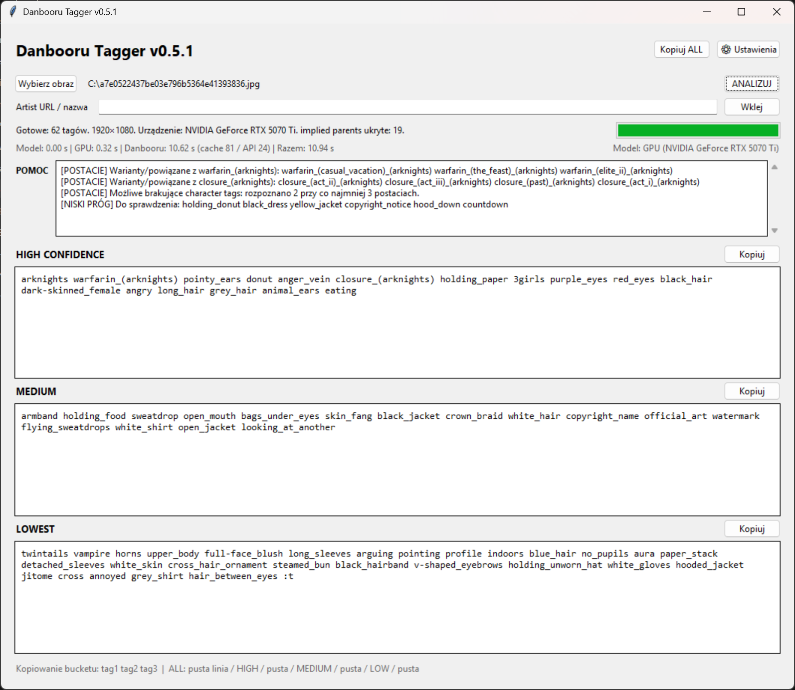

# Danbooru Tagger

**Developed with ChatGPT (OpenAI).**

Windows desktop application for tagging anime-style images with **PixAI Tagger v1.0**, local Danbooru tag metadata, and optional checks through the official Danbooru API. This is an independent project, not affiliated with Danbooru, PixAI, or OpenAI.

## Screenshot

*GUI example from v0.5.1. The current version includes LOCAL/HYBRID modes and offline SQLite metadata support.*

## Features

- Three editable confidence groups: **HIGH**, **MEDIUM**, and **LOWEST**; configurable thresholds, blacklist, and tag copying.
- **Development v0.7.3:** manually edit confidence buckets and click **Zapisz korektę** to append an opt-in JSONL review record to local `feedback/corrections.jsonl`. Image SHA-256, initial tags/confidences, reviewed tags and differences are recorded; image bytes and local file paths are not. This log is not sent to any service.
- Local inference with PixAI Tagger v1.0; NVIDIA CUDA acceleration when available, with CPU fallback.
- Danbooru metadata checks for tag existence, aliases, deprecated tags, and implications.
- Character-variant suggestions, contextual warnings, and optional raw confidence exports.
- Local JSON cache and an optional SQLite tag metadata snapshot. Existing cache and settings are retained when updating.
- **LOCAL (default):** process images and check locally available metadata without automatic Danbooru tag-API requests.
- **HYBRID (optional):** look up missing or stale information through the official Danbooru API.
- **Manual refresh:** use **Odśwież tagi (API)** after analysis to request newer metadata; analyze again to apply refreshed results.
- Recognizes Cloudflare challenges, avoids retry loops, and continues with locally available information.

## Download and installation

**Requirements:** Windows, Python 3.10 or newer (Python 3.14 preferred), and internet access for downloading the model and optional offline database. NVIDIA GPU is recommended for CUDA; CPU inference is also supported.

### New installation

1. Download the latest **FULL ZIP** from [Releases](https://github.com/AlpineNull/DanbooruTagger/releases/latest) and extract it to a writable folder.
2. Run `1_SETUP.cmd`. It installs the Python environment, downloads the PixAI model (about 2 GB), and attempts to download an offline SQLite tag database (about 175 MB).
3. Run `DanbooruTagger.vbs` to start the application.
4. If the database was not downloaded, run `2_SETUP_TAG_DATABASE.cmd` separately. The application also works without SQLite, but local metadata coverage will be limited.

### Updating an existing installation

1. Close the application and back up user data if desired.
2. Download the latest **UPDATE ZIP** from [Releases](https://github.com/AlpineNull/DanbooruTagger/releases/latest).
3. Extract the ZIP **into the existing application folder**, overwriting the old code files.
4. Start `DanbooruTagger.vbs`. Do not rerun `1_SETUP.cmd` when updating an existing installation.

The update does not overwrite your `.venv/`, `models/`, `settings.json`, `danbooru_api_key.bin`, `danbooru_cache.json`, or `danbooru_tags.sqlite`.

## Online and offline tag data

The offline SQLite database is an independently published [Danbooru tag metadata snapshot](https://huggingface.co/datasets/hlibr/danbooru-tag-metadata-snapshot) dated **2026-04-08**, downloaded separately from Hugging Face. It contains metadata, not images. The model weights and offline database are **not included** in this repository or the application ZIPs.

A tag missing from an older snapshot is **not automatically considered nonexistent**. Where JSON and SQLite disagree, the application considers their timestamps and avoids automatic destructive corrections when a conflict cannot be resolved reliably.

**Note:** If you enter an **Artist URL / name** while the optional blocked-artist precheck is enabled, the app may contact the official Danbooru API even in LOCAL mode. If the API is unavailable, artist status remains **unverified**. HYBRID mode and manual refresh also use the API. No browser impersonation or Cloudflare bypass is used.

## Privacy

Image inference runs locally; the application does not upload the image to Danbooru. Manual review feedback is saved locally only when you click **Zapisz korektę**. The `feedback/` directory is ignored by Git and preserved during normal code-only updates. API operations can submit tag names and, if supplied for the optional artist check, the artist URL/name. An API key is stored locally using Windows DPAPI. Keep `settings.json`, `danbooru_api_key.bin`, caches, and local diagnostic exports out of public repositories.

## Credits and license

**Application code developed with ChatGPT (OpenAI).** Third-party model and data sources are separately licensed.

The original application code is licensed under the [MIT License](LICENSE). The PixAI model, offline tag data, and Python dependencies remain subject to their respective licenses.
