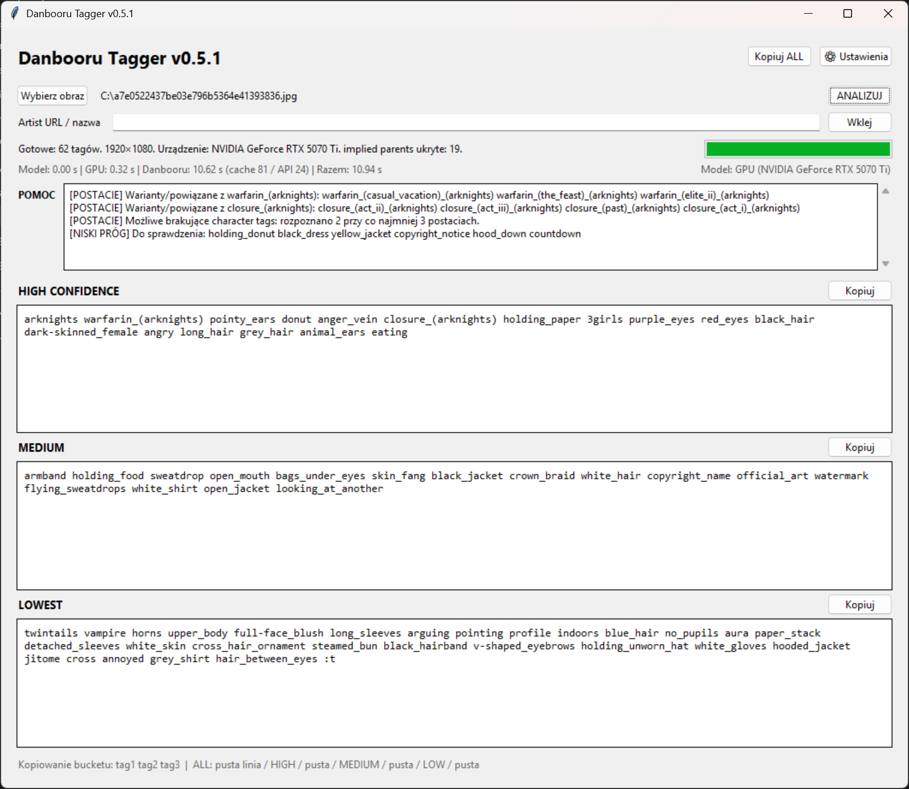

# Danbooru Tagger

A Windows desktop GUI for tagging anime-style illustrations with **PixAI Tagger v1.0**, with Danbooru-aware tag checks and cleanup.

**Current published baseline:** v0.5.1. The project is under active development and is not affiliated with Danbooru or PixAI.

## Screenshot



The screenshot demonstrates tag classification and Danbooru checks. Processing time depends on API latency and cache state.


## Features

- Three editable confidence buckets: HIGH, MEDIUM and LOWEST.
- GPU inference (NVIDIA CUDA) and CPU fallback.
- Danbooru tag existence, alias, deprecation and implication checks.
- Suggestions for missing character tags, conflicts and near-threshold predictions.
- Editable blacklist, model idle unload and timing information.
- Copy tags as space-separated strings, with no commas.

## Requirements

- Windows
- Python 3.10 or later (the installer prefers Python 3.14)
- An NVIDIA GPU for CUDA acceleration (CPU fallback is available)
- Internet connection for initial model download and Danbooru lookups

## Quick start

1. Download the source files (or a FULL release).
2. Run `1_SETUP.cmd` once to create `.venv`, install dependencies and download the model (~2 GB).
3. Start `DanbooruTagger.vbs`.
4. Choose an image, optionally enter an artist URL/name, and click **ANALIZUJ**.

Existing installations can use UPDATE releases: close the app and copy the update files over the current program directory. Do **not** rerun setup just to update the application.

**Note:** The setup script pins a specific PyTorch/CUDA version. If installation fails on another machine, review its CUDA and Python compatibility before making changes.

## Privacy and credentials

Images are analyzed locally. The app sends **tag names**, not image files, to Danbooru during tag checks. Optional artist checks use the artist URL/name. The Danbooru API key is stored locally through Windows DPAPI.

Never commit the generated `settings.json`, `danbooru_api_key.bin`, `danbooru_cache.json`, `.venv/` or `models/` folders. The included `.gitignore` excludes them; please also verify staged files before every commit.

## Development and tests

Use `test_logic.py` for logic regression checks:

```powershell
py test_logic.py
```

v0.6.0 quality/diagnostics work should be tested separately before being tagged as a release.

## Project files

- `app.pyw` — desktop GUI, inference and post-processing
- `danbooru_client.py` — Danbooru lookups and caching
- `credential_store.py` — Windows DPAPI secret storage
- `download_model.py` — PixAI model download
- `test_logic.py` — regression tests
- `1_SETUP.cmd` / `DanbooruTagger.vbs` — Windows setup and launcher

## License

This project's original application code is licensed under the [MIT License](LICENSE). The PixAI model and third-party dependencies are subject to their respective licenses and are not redistributed with this repository.
